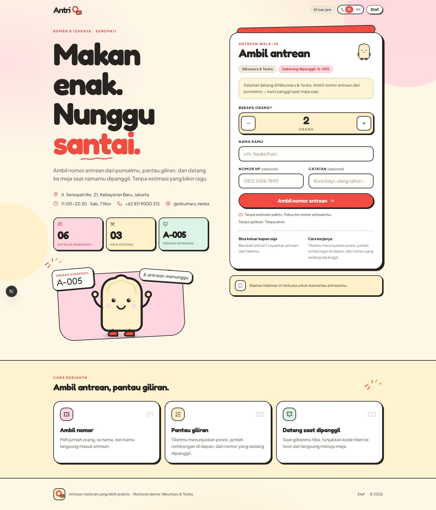
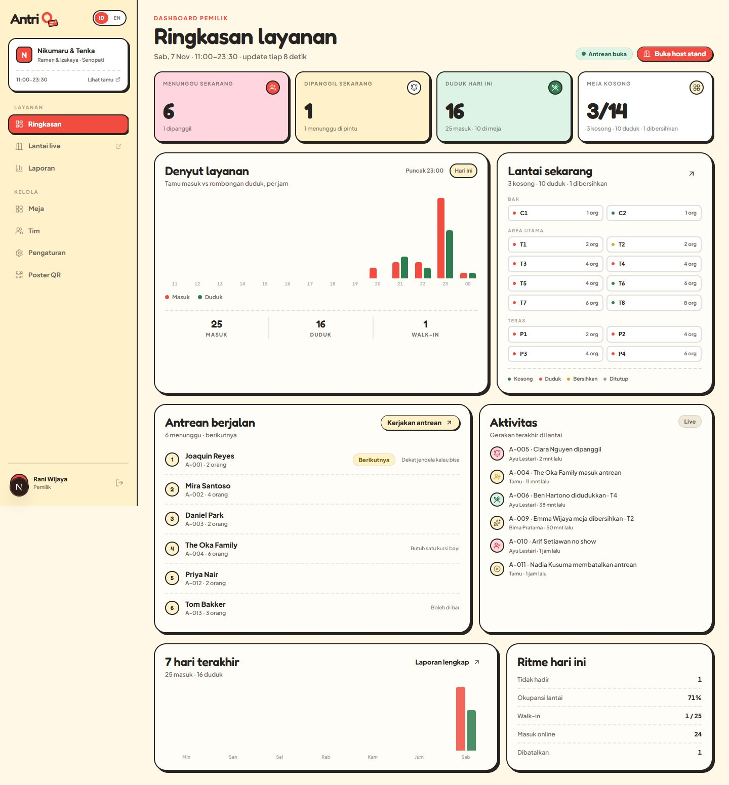
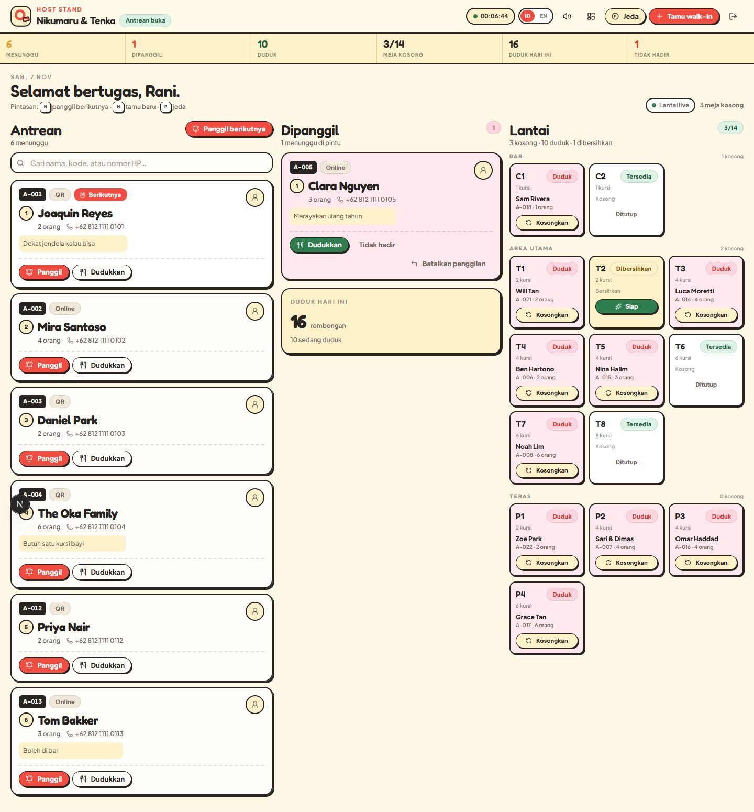
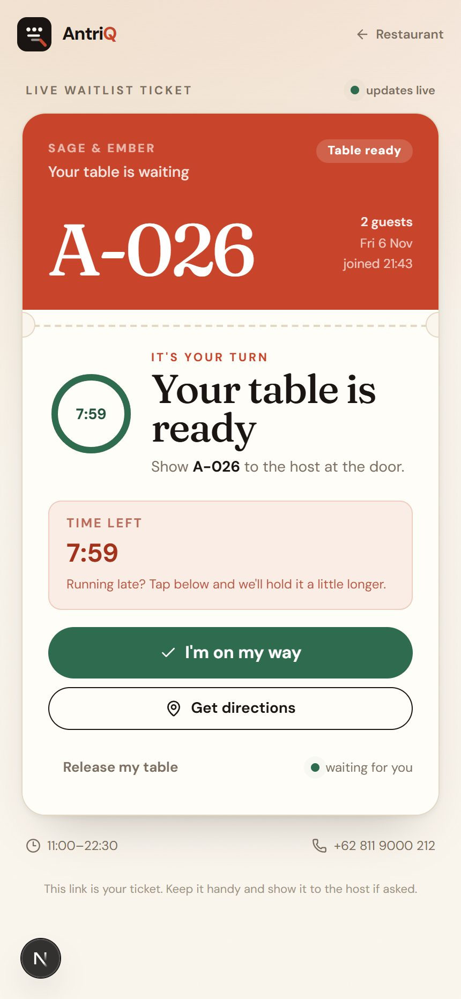

<div align="center">

# AntriQ

**Antrean restoran, lebih praktis.**  
*Makan enak. Nunggu santai.*

A bold, warm restaurant queue for guests, hosts and owners - built for multi-brand, multi-branch hospitality groups like **Nikumaru** and **Tenka**.

[Live demo](https://antriq1.vercel.app) · [GitHub](https://github.com/CASANMGT/antriq) · [PRD](docs/PRD.md) · [Architecture](docs/ARCHITECTURE.md) · [Reverse engineering](docs/REVERSE_ENGINEERING.md) · [Roadmap](ROADMAP.md) · [Changelog](CHANGELOG.md)

</div>

---

## Live environments

| Environment | URL | Data |
| --- | --- | --- |
| **App / restaurant picker** | https://antriq1.vercel.app | Live database |
| **Demo shortcut** | https://antriq1.vercel.app/demo | Redirects to the primary branch; queue starts empty after a production clear |
| **Demo branch** | https://antriq1.vercel.app/b/nikumaru/blok-m | Primary branch (empty after the production clear) |
| **Nikumaru Tebet** | https://antriq1.vercel.app/b/nikumaru/tebet | Branch page |
| **Tenka AEON Tanjung Barat** | https://antriq1.vercel.app/b/tenka/aeon-tanjung-barat | Branch page |
| **Tenka Bintaro Xchange** | https://antriq1.vercel.app/b/tenka/bintaro-xchange | Branch page |
| **Tenka KAMAJA** | https://antriq1.vercel.app/b/tenka/kamaja | Branch page |
| **Brand page** | https://antriq1.vercel.app/b/nikumaru | Brand assets + branch list |

For a true production/demo split, deploy the same repo twice with different databases:

- **Production:** `DEMO_MODE=0`, production Neon database, production `NEXT_PUBLIC_APP_URL`.
- **Demo:** `DEMO_MODE=1`, separate Neon database, demo `NEXT_PUBLIC_APP_URL`.

Clear live queue data while keeping brands, branches, staff and tables:

```bash
DATABASE_URL=postgres://… npm run db:clear -- --yes
```

Use `db:reset -- --yes` when you want a completely empty database.

## What it is

AntriQ is a multi-brand, multi-branch queue system with three connected surfaces:

| Surface | Who | What they can do |
| --- | --- | --- |
| **Guest** | Diner, no account | Open a brand or branch URL, see the live queue, take a number, watch position and now-serving, get called, see the assigned table/seat |
| **Host stand** | Host or owner (PIN) | Work the line with live wait times, call the next party, seat openly (no table required), finish the visit with **Selesai**, mark no-shows, add walk-ins |
| **Owner dashboard** | Owner (PIN, scoped by brand/branch) | Live queue counts, service pulse, floor map, activity, reports, CSV, tables, team, brand assets, branches, settings, QR poster; owners can also pause/reopen the queue |

Brands own identity and assets (logo, menu PDF, Instagram); branches own hours, tables, staff, the queue and their own public URL. A platform owner manages every brand, a brand owner manages every branch in their brand, and a branch owner manages only their branch.

**Queue-first by design:** guests see a queue number, position, parties ahead and the code being called. There are **no wait-time estimates**. After a call, an **optional 3-minute countdown** can run; it is off by default. When enabled, the operational hold drives auto no-show behind the scenes. Guest joins are only accepted during the branch's opening hours; outside hours the page shows the service window and next opening time.

**Bahasa Indonesia is the default; English is one tap away.** The language toggle stores a cookie and refreshes both server and client surfaces.




| Host stand | Live guest ticket |
| --- | --- |
|  |  |

## Demo access — Nikumaru & Tenka

A fictional **ramen & izakaya** group with two brands and three branches:

| Brand | Branch | Public URL |
| --- | --- | --- |
| Nikumaru — Japanese beef hamburg & niku rice | Blok M | `/b/nikumaru/blok-m` |
| Nikumaru — Japanese beef hamburg & niku rice | Tebet | `/b/nikumaru/tebet` |
| Tenka — tempura & katsu | AEON Mall Tanjung Barat | `/b/tenka/aeon-tanjung-barat` |
| Tenka — tempura & katsu | Bintaro Xchange Mall 2 | `/b/tenka/bintaro-xchange` |
| Tenka — tempura & katsu | KAMAJA Social Space | `/b/tenka/kamaja` |

| Role | Name | Scope | PIN |
| --- | --- | --- | --- |
| Platform owner | Owner | All brands & branches | `1234` |
| Brand owner | Owner Nikumaru | Nikumaru | `1234` |
| Host | Host Blok M | Nikumaru Blok M | `1234` |
| Host | Host Blok M 2 | Nikumaru Blok M | `1234` |
| Host | Host Blok M 3 | Nikumaru Blok M | `1234` |
| Host | Host Tebet | Nikumaru Tebet | `1234` |
| Brand owner | Owner Tenka | Tenka | `1234` |
| Host | Host KAMAJA | Tenka KAMAJA | `1234` |

Open `/login`. Staff names are intentionally generic; new and reset PINs default to `1234`. Demo shortcuts appear in local development only; production never shows demo PINs.

> With `DEMO_AUTO_RESET=1`, the demo resets its floor on the first request of each new day, even on a warm serverless instance. Leave `DEMO_AUTO_RESET=0` in production so clearing a queue stays cleared.

## Brand system

The UI is built from the uploaded AntriQ brand direction:

| Token | Value | Use |
| --- | --- | --- |
| Tomato Red | `#F24B3F` | Primary actions, called state, highlights |
| Butter | `#FFF1CA` | Surfaces, queue stats, poster headline |
| Ink | `#262321` | Text, 2px outlines, offset shadows |
| Soft Pink | `#FFD6DF` | Waiting/warm states, secondary cards |
| Leaf | `#2E7D4F` | Seated/ready/success |
| Display | **Fredoka** | Headlines, numbers, the wordmark |
| UI | **Plus Jakarta Sans** | Body, controls, tables |

Chunky 2px outlines, sticker shadows, red brush accents, the toast mascot, and warm paper backgrounds carry across the guest app, ticket, host stand, owner dashboard, login and printable QR poster.

## Features

### Guest
- **Restaurant picker at `/`** with every brand and branch, live waiting/tables/now-serving, address, hours, menu and Instagram. Visitors can share their location to sort restaurants nearest first and see the distance to each branch.
- Brand page (`/b/[brand]`) with logo, menu PDF, Instagram and branch cards.
- **Circular brand avatars** on the picker, branch, brand and ticket surfaces.
- QR poster uses a **1600px high-resolution, high-error-correction QR** and prints on A4 at 68mm.
- Queue screen includes an owner QR-poster shortcut.
- Live queue snapshot: **one group by default**, now serving and branch status. Owners can switch to **two groups - A (1-2), B (3+)** in Settings. No empty-table count.
- **Queue control:** owners can pause new joins and reopen the queue from the dashboard; existing guests keep their place.
- **Service-hours gate:** outside opening hours the join form becomes an opening-hours panel with the next opening time, and guest joins are rejected server-side.
- **In-app version + changelog:** `/changelog`, linked from the guest footer, ticket, owner sidebar, mobile nav and host header.
- **One active ticket per guest:** duplicate protection by device cookie and phone; the join form becomes an existing-ticket panel until the ticket is released or completed. A seated guest can tap **“Selesai Antrian”** to close the ticket and clear this device’s history before joining again.
- **Mobile-first join card comes first**: name, party size and “Ambil nomor antrean” before the long brand/queue details.
- **“Saya hadir”** is optional per branch and off by default. When enabled, the owner chooses whether it stops the countdown or adds minutes.
- Notification opt-in includes Firefox guidance (lock icon → Permissions → Notifications).
- Staff link is only a subtle footer link; the guest top nav has no staff entry.
- Queue-only mode is the default: parties are seated openly without a table or seat number.
- Take a number in about 20 seconds: party size, name, optional phone/note.
- Ticket with a human code (`A-024`), queue position, parties ahead, now-serving code. The guest ticket does not show a join time or wait duration.
- Called state: **“Meja siap!”** with an optional **3-minute countdown** (off by default), optional “Saya hadir” (stops or extends the countdown), directions and release.
- Browser notification permission prompt on the ticket, plus a notification when the call changes while the tab is hidden.
- Seated state shows the open-seat confirmation, or the assigned table/seat when the branch uses the table plan. Host name and directions are hidden once seated.
- Host queue cards show the live waiting time; seated cards show the wait until the call.
- Completed, no-show and cancelled end states.
- Capability URL + local ticket memory; no account.
- Mobile-first, installable, reduced-motion aware, Indonesian/English.

### Host stand
- PIN login, 12-hour signed session, branch-scoped access.
- Three-column board: **Antrean / Dipanggil / Lantai** — tabs on phones.
- Branch switcher for owners and brand owners.
- Queue positions on every card, not waiting-time guesses.
- **Call next** selects the first party a free table can physically seat; suggests the smallest fitting table.
- Seat from waiting or called at a specific table and optional **seat number**, or use **Open seat** to skip the number entirely.
- **Queue-only mode** (default): tap **Seat** once, no table or seat number, then release from the **Seated** list.
- Manual mode adds a seated list without table numbers; Table plan adds tables + optional seat numbers.
- Live stats: waiting, called, seated, seated today, no-shows. The table stat is hidden in queue-only mode.
- When the countdown is enabled, called cards show the live countdown; it pauses when the guest confirms they are on the way if the branch enables the button.
- Browser notification prompt, plus a hidden-tab notification when a guest is called from another device.
- **Release seat** after payment or when a visit ends; records the staff member who released it.
- No-show with confirmation, undo call, walk-in add, search.
- Table lifecycle: seated → dirty → ready, plus blocked. Seated cards show seat and PIC.
- Pause / close / reopen queue, optional call chime, shortcuts (`N`, `W`, `P`).
- Live stats: waiting, called, seated, tables open, seated today, no-shows.

### Owner
- Brand → branch switcher; every view, report and QR link is branch-scoped.
- Queue-focused KPIs: waiting, called, seated today, tables open.
- Hourly service pulse (joined vs seated), floor map by zone, live queue, activity feed.
- 7/30/90-day reports: joined, seated, attendance, no-shows, cancellations, CSV (incl. table, seat, PIC). Owners can switch to **all branches**; the view and CSV stay scoped to the branches they manage.
- **Customers** page: contact, party, status, table/seat, opener/releaser PIC, join time, 1/7/30-day ranges.
- Tables CRUD with capacity/zone and seated-table protection.
- Team management: owner/host roles, generic display names, brand + branch assignment, reset PIN (default `1234`), pause access, last-owner protection.
- **Brands:** name, slug, Instagram, accent, logo upload, menu PDF upload.
- **Branches:** create/edit name, slug, address, phone, timezone, hours, announcement.
- Settings: identity, accent, timezone, hours, max party (default 10), queue cap, auto no-show, announcement, **queue groups** (1 group by default, or split A/B), **seating mode** (queue-only, manual, or table plan), **optional “time to table” countdown**, **optional “Saya hadir” button**, and **what it does** (stop or add minutes).
- Printable A4 QR poster whose QR points at the branch URL.

## Stack

| Layer | Choice |
| --- | --- |
| Framework | **Next.js 16** App Router + React 19 |
| Styling | **Tailwind CSS 4** + custom brand tokens |
| Type | **Fredoka** + **Plus Jakarta Sans** via `next/font` |
| Database | **Postgres** (`postgres.js`); **PGlite** for tests |
| Auth | Signed HTTP-only cookie + scrypt staff PINs |
| Icons | lucide-react |
| QR | `qrcode` |
| Tests | Vitest (domain + PGlite integration) |

```text
Guest phone ─┐
Host tablet ─┼─► Next.js on Vercel ──► Postgres (Neon)
Owner laptop ┘      │
                    ├─ Server Components: first paint + metadata
                    ├─ Route handlers /api/*: JSON reads/writes
                    └─ lib/queue.ts: pure queue rules
```

Writes go through JSON route handlers; reads are server-rendered then polled (4s guest/host, 8s owner). No websocket vendor, no client-side database access. See [docs/ARCHITECTURE.md](docs/ARCHITECTURE.md).

## Quick start

**Requirements:** Node 20.9+ and Docker.

```bash
git clone https://github.com/CASANMGT/antriq.git
cd antriq
npm install

docker compose up -d db
cp .env.example .env.local
# edit AUTH_SECRET (everything else works for local demo)

npm run dev
```

Open:

- Guest — http://localhost:3000 is the restaurant/branch picker
- Demo shortcut — http://localhost:3000/demo
- Brand — http://localhost:3000/b/nikumaru
- Branch — http://localhost:3000/b/nikumaru/blok-m or `/b/nikumaru/tebet`, `/b/tenka/kamaja`
- Staff login — http://localhost:3000/login
- Owner — http://localhost:3000/dashboard
- Health — http://localhost:3000/api/health

The schema is created and seeded automatically on the first request. v0.3 detects a legacy v0.2 database and moves the old tables into an `antriq_v2_backup` schema (data preserved) before creating the new brands/branches model. If you prefer a clean reset:

```bash
DATABASE_URL=postgres://… npm run db:reset -- --yes
```

`docker compose down -v` also resets the local database.

```bash
npm run dev       # development
npm run build     # production build
npm start         # production server
npm run lint      # ESLint (Next 16 + React 19 rules)
npm test          # 26 domain + integration tests
```

## Deploy to Vercel

The current production deployment is **https://antriq1.vercel.app** (Vercel project `antriq1`), backed by a free **Neon Postgres** database in Singapore.

1. Push the repo to GitHub.
2. Create Postgres (Neon / Supabase / Vercel Postgres) and copy the pooled connection string.
3. Import the repo in Vercel and set:

| Variable | Example | Notes |
| --- | --- | --- |
| `DATABASE_URL` | `postgres://…` | **Required.** Pooled URL in Singapore (`sin1`). |
| `AUTH_SECRET` | 32+ random chars | Required in production. |
| `NEXT_PUBLIC_APP_URL` | `https://antriq1.vercel.app` | Metadata + QR poster. |
| `DEMO_MODE` | `1` | Optional; seeds the demo floor on an empty database. |
| `DEMO_AUTO_RESET` | `0` | Optional; re-seeds the demo floor when a service day is empty. Keep off in production. |

4. Deploy. The first request runs idempotent schema creation and seeding under a Postgres advisory lock.
5. `vercel.json` pins functions to **Singapore (`sin1`)**; keep the Neon primary region in Singapore too. Use a separate Neon branch/project and a separate Vercel Preview environment for **staging**.

> The app also has a PGlite fallback for local experiments, but production **must** use `DATABASE_URL`; serverless instances do not share `/tmp`.

### Staging and production

- **Production:** `antriq1` project + `NEXT_PUBLIC_APP_URL=https://antriq1.vercel.app` + production Neon database.
- **Staging:** a second Vercel environment (Preview or a separate project) with its own Neon branch, `AUTH_SECRET`, and `NEXT_PUBLIC_APP_URL`.
- Run `npm run db:reset -- --yes` once against each new database when moving from v0.2, then let the app seed.
- Never point staging and production at the same database.

### CI

The initial GitHub token lacked the `workflow` scope, so the CI definition lives at [`docs/ci-example.yml`](docs/ci-example.yml). Copy it to `.github/workflows/ci.yml` when available; it runs lint, tests and a production build.

## API

| Method | Route | Auth | Purpose |
| --- | --- | --- | --- |
| `GET` | `/api/health` | public | Liveness + DB check |
| `POST` | `/api/join` | public (rate-limited) | Take a queue number at a branch (`branchId`) |
| `GET` | `/api/ticket/[token]` | capability token | Live ticket |
| `POST` | `/api/ticket/[token]/action` | capability token | `cancel` / `acknowledge` |
| `GET` | `/api/host/state?branch=` | staff | Branch host board snapshot |
| `POST` | `/api/host/action` | staff | `callNext`, `callEntry`, `seat` (+ `seatNumber`), `noShow`, `undoCall`, `walkin`, `clearTable`, `tableStatus`, `waitlist` |
| `GET` | `/api/owner/overview?branch=&days=7` | owner | Branch queue counts, chart, activity, floor |
| `POST` | `/api/owner/action` | owner | `settings`, `brand*`, `branch*`, `waitlist`, `table*`, `staff*` |
| `POST` | `/api/owner/brand/asset` | owner | Multipart logo/menu upload |
| `GET` | `/api/owner/export?branch=&days=30` | owner | Branch CSV download |
| `GET` | `/api/brands/[id]/logo` | public | Brand logo bytes |
| `GET` | `/api/brands/[id]/menu` | public | Brand menu PDF |

All writes are validated, parameterised, and return `{ ok, message, data }`. Host and owner APIs enforce the session's brand/branch scope.

## Data model

```text
brands (identity, logo bytea, menu bytea, Instagram)
  └─ branches (URL slug, hours, queue policy, announcement)
       ├─ staff (owner | host, brand_id / branch_id scope, scrypt pin_hash)
       ├─ dining_tables (capacity, zone, status)
       ├─ queue_entries (branch_id, token, code, day+seq, party, status,
       │                  table_id, seat_number, opened_by, opened_by_staff_id,
       │                  hold_expires_at)
       ├─ queue_sequence (per branch + day atomic ticket counter)
       └─ activity (branch audit feed, jsonb detail)
```

Brand assets live in Postgres (`bytea`) and are streamed by `/api/brands/[id]/…`; no object-storage vendor is required. Full DDL: [`lib/schema.ts`](lib/schema.ts). State machines and invariants: [docs/ARCHITECTURE.md](docs/ARCHITECTURE.md).

## Security & privacy

- Diner tickets are **capability URLs** (`/t/<22-char random>`).
- Staff sessions: HMAC-signed, HTTP-only, SameSite=Lax, 12h.
- PINs: salted **scrypt** hashes; never logged or returned.
- Owner guards and brand/branch scope on every owner page and API.
- Host branch scope on every host API.
- Rate limits on joins, ticket actions and login attempts.
- Positional SQL only; input length/enum validation.
- No third-party analytics or tracking scripts.
- Guest names/phones visible only to staff and the ticket holder.
- `robots.txt` disallows `/host`, `/dashboard`, `/t/`, `/api/`.

## Tests

```bash
npm test
```

- **Domain:** ticket codes, FIFO, best-fit table, smart call, ETA engine (internal), stats, hourly buckets, turn fallback.
- **Integration on PGlite:** multi-brand/branch seed, PIN verification, join → ticket → cancel, call next, table + seat number + PIC, capacity refusal, no-show, undo, hold expiry, pause + walk-in, owner metrics, CSV.

See [docs/QA.md](docs/QA.md) for the release checklist.

## Project layout

```text
app/
  page.tsx                 Customer restaurant/branch picker
  demo/                    Demo shortcut to the primary branch
  b/[brand]/               Brand page: logo, menu, Instagram, branch cards
  b/[brand]/[branch]/      Guest branch landing + join
  t/[token]/               Live ticket
  login/                   Staff PIN login
  host/                    Host board (?branch=)
  dashboard/               Owner: overview, reports, customers, tables, team, brands, branches, settings, QR
  api/                     JSON reads/writes
components/
  diner/ host/ owner/ ticket/ login/   Surface components
  Logo, Mascot, LanguageToggle, ...
lib/
  queue.ts                 Pure domain rules
  store.ts                 Queries + mutations
  scope.ts                 Owner branch resolution
  db.ts                    Postgres / PGlite adapter
  schema.ts                Idempotent SQL schema
  seed.ts                  Demo brands, branches and floor
  i18n.ts                  Indonesian + English dictionary
  auth.ts                  Sessions + throttling
  labels.ts                Zone labels
scripts/reset-db.mjs       One-time v0.2 → v0.3 schema reset
tests/                     Vitest suites
docs/                      PRD, architecture, migration, reverse engineering, QA
```

## Why “AntriQ”?

“Antri” is Indonesian for *queue*. AntriQ is the queue, answered.

## License

MIT — see [LICENSE](LICENSE).
